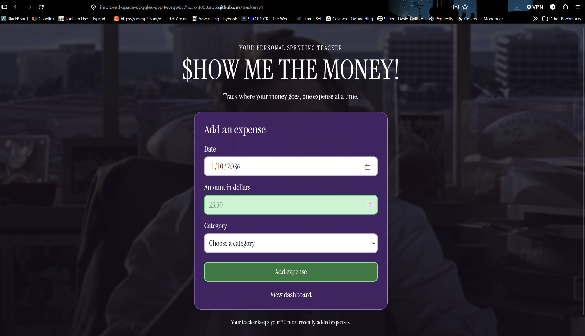
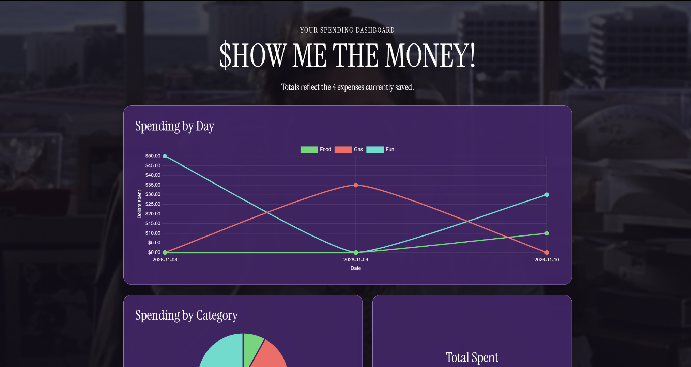
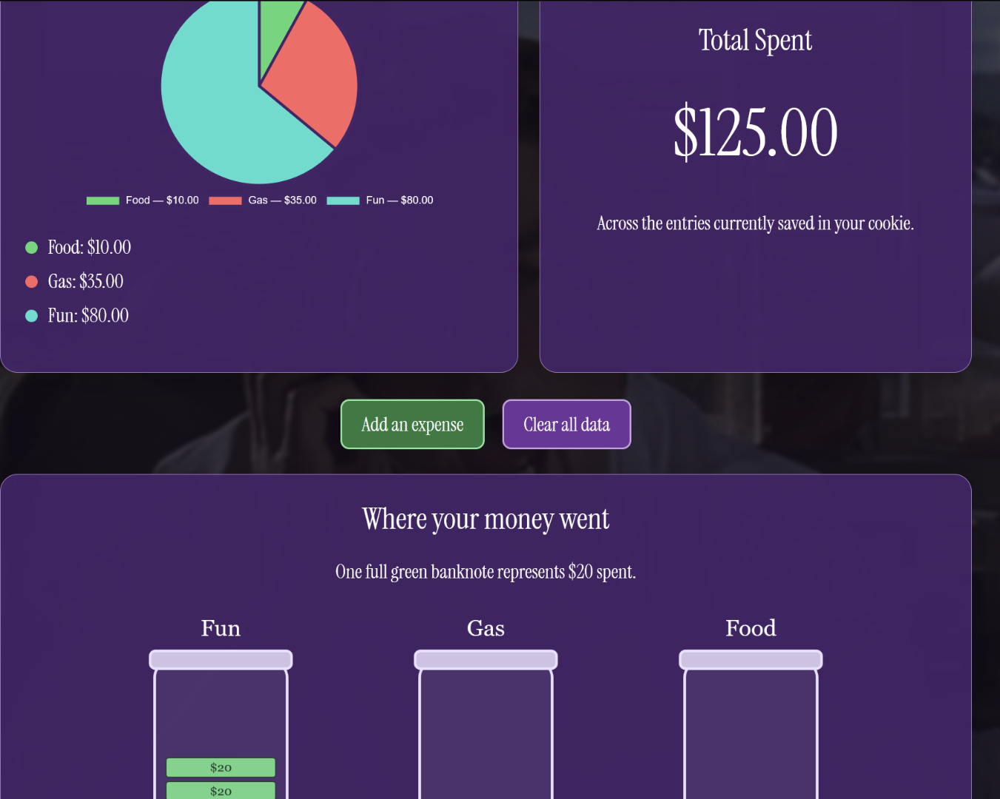
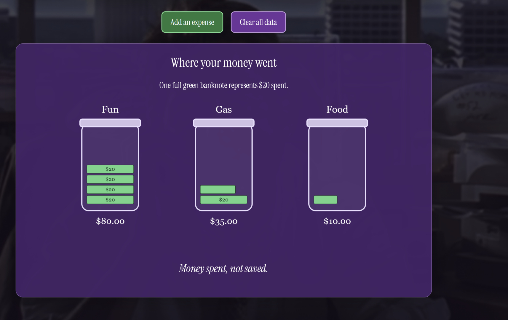
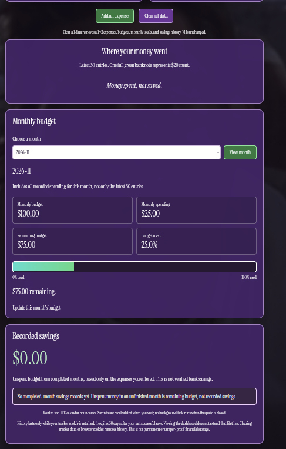
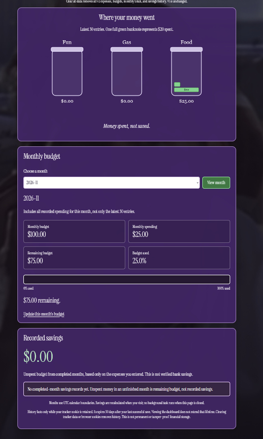
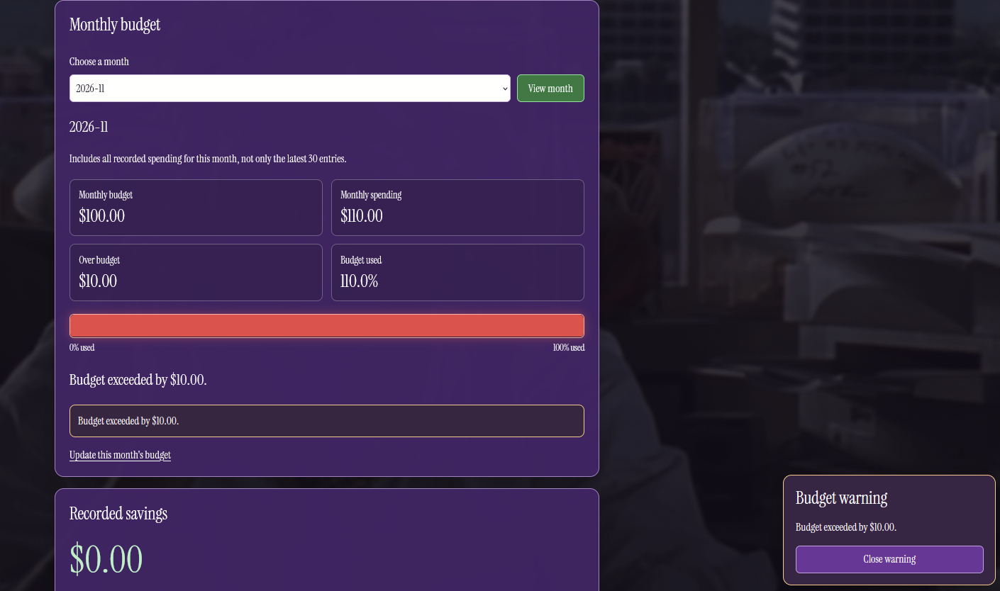

# show-me-the-money
Money tracking app for CIM343

https://youtu.be/Z_0NJxvanCM Video walkthrough

## Prompt documents

- [Prompt v1](tracker-docs/prompt-v1.md)
- [Prompt v2 and v1 test log](tracker-docs/prompt-v2.md)

## Version 2 changes

Version 1 records expenses and displays two charts, category totals,
Total Spent, and three p5.js spending jars.

Version 2 adds:
- A separate monthly budget form.
- Monthly spending totals that are retained independently of the
  latest 30 detailed expense entries.
- A budget meter beneath the jars.
- A cool-to-warm color gradient and a red over-budget state.
- A warning when 25% or less of the monthly budget remains.
- Recorded savings for completed months.
- Recalculation of completed-month savings when late expenses are added.

The charts and jars show the latest 30 detailed entries across months.
The monthly budget panel shows all recorded spending for its selected month.

## V2 test results

| Test | Observed result |
|------|-----------------|
| $100 budget with $25 spending | Showed $75 remaining, 25% used, and a quarter-filled meter. |
| $100 budget with $75 spending | Showed $25 remaining, 75% used, and the low-budget popup. |
| Reached the $100 budget | Showed 100% used, a fully red meter, and a budget-reached warning. |
| Exceeded the budget by $10 | Showed $110 spent, 110% used, and $10 over budget. The meter stayed within its border. |
| October budget of $500 with $400 spending | Showed $100 in recorded savings. |
| Added a late October expense of $25 | October spending became $425 and recorded savings decreased to $75. |
| Initial v2 chart rendering | Charts and jars were blank. Reusing the unchanged working scripts restored them. |
| Initial budget script loading | The meter was empty because the requested filename did not match the saved file. Renaming the file restored the meter. |

### Tests not yet independently confirmed

- Popup staying dismissed after scrolling away and back.
- Scroll animation playing once per page load.
- V2 monthly totals remaining accurate after more than 30 entries.
- V2 clearing without affecting v1.
- V2 server rejection of all invalid-input cases.

## Manual edits and corrections after v2 generation

- Removed accidentally duplicated server-start blocks and an unfinished
  app.listen wrapper from app.js. Kept one app.listen at the bottom.
- Removed instructional placeholder comments that had been pasted
  into app.js.
- Changed dashboard-v2.hbs to load the unchanged dashboard.js and
  jars.js scripts instead of dashboard-v2.js and jars-v2.js.
  This restored the charts and jars.
- Renamed public/js/budget-v2.js to public/js/budget.js to match
  the script reference in dashboard-v2.hbs. This restored the
  budget meter and warning script.

## Storage and savings limitations

- V1 uses MoneySpent_v1; v2 uses MoneySpent_v2.
- Data is stored in server-managed cookies, not a database.
- V2 keeps the latest 30 detailed expenses plus separate monthly records.
- The cookie expires 30 days after the last successful save.
- Viewing the dashboard does not renew its lifetime.
- Recorded savings means unspent budget based on entered expenses,
  not verified bank savings.
- Completed-month savings are calculated when the dashboard is viewed.
- Clearing v2 data or losing its cookie removes its budgets and history.
- The jar drawing uses a 100-visible-banknote safeguard.
- Large jar drawings may require scrolling inside the jar section.

| Initial budget script loading | The meter was empty because the requested filename did not match the saved file. Renaming the file restored the meter. |

| Refreshed the dashboard twice | Latest-entry spending stayed at $535.00, October spending stayed at $425.00, and recorded savings stayed at $75.00. No duplicate spending or savings appeared. |
| Submitted abc as an expense amount with browser validation bypassed | The server displayed a readable amount error. Existing spending and savings remained unchanged. |

## Screenshots

### Version 1

#### Expense form



#### Daily spending chart



#### Category spending and total



#### Spending jars



### Version 2: testing and corrections

#### Initial chart-rendering problem

The chart panels were blank even though the spending totals appeared.


#### Initial jar-rendering problem

The new budget section appeared, but the jars were missing.



#### Budget script filename problem

The jars were restored, but the budget meter remained empty
because the script filename and its reference did not match.



#### Working over-budget display

After the script correction, the meter showed a full red bar,
110% budget usage, and a warning that spending exceeded
the budget by $10.



- Deleted the unused, empty dashboard-v2.js file. Both dashboards
  use dashboard.js to draw charts from the data supplied by their
  own Express routes.


  *** Code Explanation ***

  # Cookie Tracker – <$how Me the Money! - 30 days of Budegting and Spending>

🎥 **Video walkthrough:** <https://youtu.be/Z_0NJxvanCM>

## What I tracked and why
I tracked money spending across 3 different categories because i wanted to see how much i would spendin a b=month. Then i decided to create a budget to make sure i stayed on track.

## Version 1 (prompt v1)
[Prompt v1]It first started with a sketch i made on Procreate designing both screens in order to get a better idea of how i wanted it prompted. Perplexity then developed its own proper prompt analyzing the image of my sketches which came up with: (tracker-docs/prompt-v1.md)


**What worked / what didn't: **
Honestly the first rendition went well. The AI tried to get me to use GitHubs agent to put my prompt in but i used my LLM instead. 

## Version 2 – Final (prompt v2)
[Prompt v2](tracker-docs/prompt-v2.md)


**Biggest change from v1 to v2, and why it helped:**
adding the budgeting. it helped because now i can see how much i can save and how close i am to reach my limit. 

**Hand edits I made (if any):**
...

## How my code works (in my own words)
My app saves the tracker data in a cookie instead of a database.
When I submit an expense, Express checks the input and uses res.cookie to save the updated data. When I open the dashboard, cookie-parser makes the saved data available through req.cookies. The dashboard reads that data again, which is why the expenses stay after refreshing. The cookie lasts for 30 days after the last save.

### Saving the cookie
My cookie is named MoneySpent_v2.

```javascript
const v2CookieName = "MoneySpent_v2";
const v2CookiePath = "/tracker/v2";
```

The reading helper starts with this line:

```javascript
const saved = req.cookies[v2CookieName];
```

This reads the saved cookie sent by the browser. The rest of the helper checks the cookie's structure, entries, and monthly records before using them. If there is no cookie, it creates empty data.

My expense route starts like this:

```javascript
// Validate an expense and update its monthly total exactly once.
app.post("/tracker/v2", function(req, res) {
    const result = v2Read(req);
    const date = req.body.date;
    const amount = req.body.amount;
    const category = req.body.category;
    const cents = amountToCents(amount);
```

This is the beginning of the route, not the whole route.

- app.post runs when I submit the expense form.
- v2Read reads and checks the existing cookie.
- req.body gets the date, amount, and category from the form.
- amountToCents checks the amount and converts it into integer cents.

The route then checks the date, amount, category, and monthly budget. After those checks pass, this block adds the expense:

```javascript
if (!error) {
    record.spent += cents;

    result.data.entries.push({
        date: date,
        amount: cents / 100,
        category: category
    });

    result.data.entries = result.data.entries.slice(-30);

    error = v2Save(res, result.data);
}
```

- record.spent adds the expense to the monthly total in cents.
- entries.push adds the expense to the detailed entry list.
- cents / 100 stores the entry amount in dollars.
- slice(-30) keeps the latest 30 submitted entries.
- v2Save checks and saves the updated data.

Inside v2Save, this code sends the cookie back to the browser:

```javascript
res.cookie(v2CookieName, data, {
    maxAge: 30 * 24 * 60 * 60 * 1000,
    path: v2CookiePath,
    httpOnly: true,
    sameSite: "lax"
});
```

- res.cookie sends the updated MoneySpent_v2 cookie in the server response.
- data contains the expense entries and monthly records.
- maxAge gives the cookie a 30-day lifetime after saving.
- path limits the cookie to the v2 tracker path.
- httpOnly prevents browser JavaScript from reading the cookie directly.
- sameSite limits when the browser sends it with cross-site requests.

The save helper also checks the data size before setting the cookie. If the data is too large, it returns an error instead of saving it.


### Getting the data to the dashboard
javascript
// Render charts from recent entries and budgeting from monthly records.
app.get("/tracker/v2/dashboard", function(req, res) {
    const result = v2Read(req);
    let month = req.query.month;

    if (!v2ValidMonth(month) || month > v2CurrentMonth()) {
        month = v2CurrentMonth();
    }

    if (
        month !== v2CurrentMonth() &&
        !v2FindMonth(result.data, month)
    ) {
        month = v2CurrentMonth();
    }

    const view = buildDashboard(result.data.entries);
    const budgetView = v2BudgetView(result.data, month);

    Object.assign(view, budgetView);
    view.notice = result.notice;

    res.render("dashboard-v2", view);
});
```

This GET route runs when I open the dashboard. First, v2Read reads and checks the cookie using req.cookies. The route then checks the selected month. buildDashboard prepares the recent-entry totals and chart data. v2BudgetView prepares the selected month's budget meter and the completed-month savings. Object.assign combines those results. res.render passes them to the dashboard-v2 Handlebars template.
The browser scripts use the data included in that page to draw the visuals. Refreshing reads the saved data again instead of adding another expense.

### Chart 1
My first chart is a daily spending line chart.

This excerpt from buildDashboard in app.js groups expenses by date and category:

```javascript
const totals = { food: 0, gas: 0, fun: 0 };
const daily = {};
const dates = [];
let totalCents = 0;

for (let i = 0; i < entries.length; i++) {
    const entry = entries[i];
    const cents = Math.round(entry.amount * 100);

    totals[entry.category] += cents;
    totalCents += cents;

    if (!daily[entry.date]) {
        daily[entry.date] = { food: 0, gas: 0, fun: 0 };
        dates.push(entry.date);
    }

    daily[entry.date][entry.category] += cents;
}

dates.sort();
```

The loop adds the spending together using cents. Expenses with the same date and category become one daily total.

Each date is added to the dates list once. dates.sort puts the dates in order.

The function includes this property in the data it returns to the template:

```javascript
chartData: JSON.stringify({
    dates: dates,
    daily: daily,
    totals: totals
})
```

JSON.stringify turns the prepared data into text so it can be included in the page.

In dashboard.js, this code reads that data:

```javascript
const dashboardData = JSON.parse(
    document.getElementById("dashboard-data").dataset.values
);

const categoryNames = ["food", "gas", "fun"];
const categoryLabels = ["Food", "Gas", "Fun"];
const categoryColors = ["#55d878", "#ff6565", "#40e0d0"];
```

JSON.parse turns the data back into a JavaScript object.

The category arrays give each line a name and color. Food is green, Gas is red, and Fun is turquoise.

This excerpt builds the chart's datasets:

```javascript
const datasets = [];

for (let i = 0; i < categoryNames.length; i++) {
    const category = categoryNames[i];
    const values = [];

    for (let j = 0; j < dashboardData.dates.length; j++) {
        const date = dashboardData.dates[j];

        values.push(dashboardData.daily[date][category] / 100);
    }

    datasets.push({
        label: categoryLabels[i],
        data: values,
        borderColor: categoryColors[i],
        backgroundColor: categoryColors[i],
        borderWidth: 3,
        pointRadius: 4,
        tension: 0.15
    });
}
```

The outside loop goes through the three categories. The inside loop gets each category's spending for every date. Dividing by 100 converts cents into dollars. Each category gets its own values, label, and color.

My Chart.js configuration uses these settings:

```javascript
type: "line",
data: {
    labels: dashboardData.dates,
    datasets: datasets
},
```

The dates become the labels along the bottom. The datasets become the three spending lines.

### p5 sketch
My p5 sketch draws one spending jar for Fun, Gas, and Food.

```javascript
const noteValueCents = 2000;
```

Each full banknote represents 2,000 cents, or $20.

Inside drawJar, these calculations decide how many notes are needed:

```javascript
const fullNotes = Math.floor(cents / noteValueCents);
const remainder = cents % noteValueCents;
const totalNotes = Math.ceil(cents / noteValueCents);
const visibleNotes = Math.min(totalNotes, 100);
```

fullNotes counts the complete $20 notes. remainder finds the amount left over.

totalNotes includes a partial note if one is needed. visibleNotes limits the drawing to 100 notes per jar.

This loop stacks the notes:

```javascript
for (let i = 0; i < visibleNotes; i++) {
    let fraction = 1;

    if (i === totalNotes - 1 && remainder > 0) {
        fraction = remainder / noteValueCents;
    }

    const y = bottom - 18 - noteHeight -
        i * (noteHeight + noteGap);

    drawBanknote(left + 13, y, jarWidth - 26, fraction);
}
```

A fraction of 1 makes a full-width note. The last note uses a smaller fraction if there is a remainder.

The y calculation moves each note upward to make a stack.

This function draws each note:

```javascript
// Draw a full $20 banknote or a proportional remaining banknote.
function drawBanknote(x, y, width, fraction) {
    const visibleWidth = width * fraction;

    stroke("#163d25");
    strokeWeight(1);
    fill("#6bd68a");
    rect(x, y, visibleWidth, noteHeight, 3);

    if (fraction === 1) {
        noStroke();
        fill("#163d25");
        textAlign(CENTER, CENTER);
        textSize(14);
        text("$20", x + width / 2, y + noteHeight / 2);
    }
}
```

visibleWidth controls the note's width. fill makes it green, and rect draws its shape.

For example, $25 is one full $20 note and a quarter-width note for the remaining $5.

The jars show money spent, not money saved. The exact category total appears below each jar. If more than 100 notes are needed, the sketch explains that only the first 100 are pictured.


## Something the AI got wrong
It messed up when we made the first rendition of the budgeting where it removed the line chart and pie chart as well as the p5 sketch. 